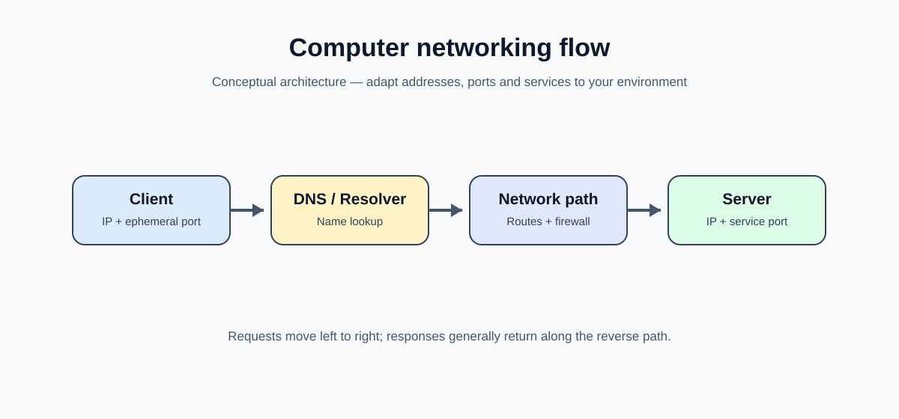

# Computer Networking

Understand how systems communicate using IP addresses, ports, TCP/UDP, HTTP/HTTPS, routing, and firewalls.



## Learning objectives
By the end of this topic, you should be able to explain the purpose of the technology, describe the request flow, identify its place in a cloud architecture, and troubleshoot common failures.

## Core concepts
- **IP address:** identifies a network interface.
- **Port:** identifies an application/service on a host (for example, HTTPS commonly uses TCP 443).
- **TCP:** connection-oriented transport with ordered, reliable delivery.
- **UDP:** connectionless transport with lower overhead; delivery/order are not guaranteed.
- **HTTP/HTTPS:** application-layer protocols; HTTPS protects HTTP using TLS.
- **Subnet/CIDR:** describes an IP address range, such as `10.0.1.0/24`.
- **Route table:** determines the next hop for traffic.
- **Security group/firewall:** controls allowed network traffic.

## Request flow
1. A client resolves a hostname using DNS.
2. The client establishes a transport connection to the destination IP and port.
3. For HTTPS, the client and server negotiate TLS.
4. The client sends an HTTP request.
5. The server processes it and returns a response.

## Hands-on commands
```bash
ip addr
ip route
ss -tulpen
ping -c 4 1.1.1.1
curl -Iv https://example.com
traceroute example.com       # install traceroute if needed
```

## Troubleshooting checklist
1. Is the hostname resolving? Use `dig` or `nslookup`.
2. Is the destination IP correct?
3. Is there a route to the destination?
4. Is the required port listening? Use `ss -lntp`.
5. Do host firewalls and cloud security rules allow the traffic?
6. Is the application healthy, not merely the port open?

## Interview checks
- Explain IP address vs port.
- Compare TCP and UDP.
- Explain what happens when you open an HTTPS website.
- Explain why a security group rule should usually reference another security group for AWS application-to-database traffic.


## Production thinking
When applying this topic in a real environment, document:
- The source and destination of traffic.
- Protocols and ports.
- Public and private network boundaries.
- Authentication and encryption requirements.
- Failure behavior and monitoring.
- Operational ownership and rollback procedure.

## Further practice
Draw this architecture from memory, then explain it aloud as if you were describing a production incident or design review.
