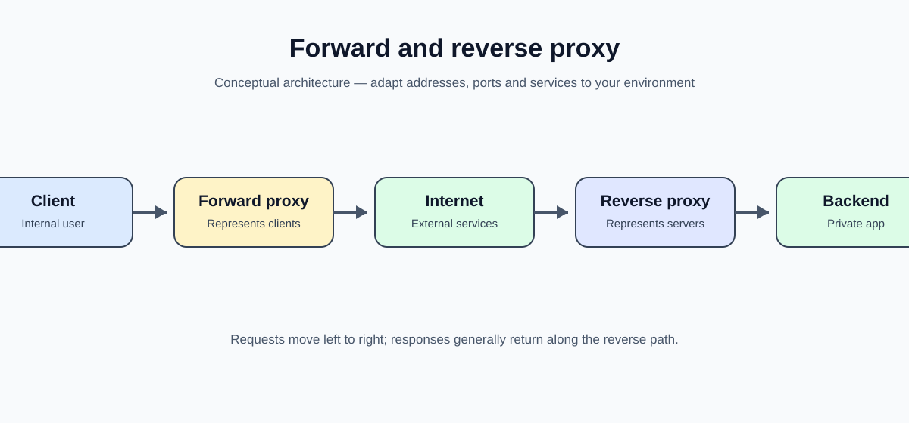
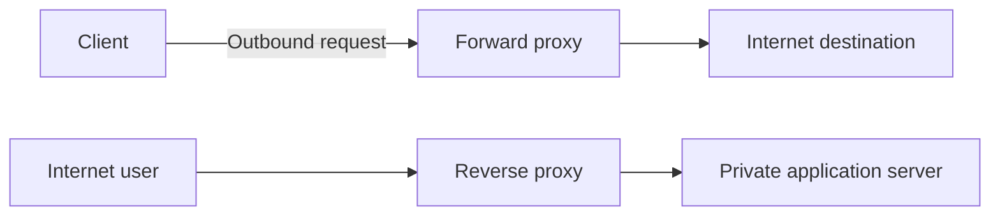

# Proxy, Forward Proxy & Reverse Proxy

Understand the proxy pattern and the difference between proxies that represent clients and proxies that represent servers.

## Learning objectives
By the end of this topic, you should be able to explain the purpose of the technology, describe the request flow, identify its place in a cloud architecture, and troubleshoot common failures.

## What is a proxy?
A proxy is an intermediary that receives a request and forwards it to another system.

## Forward proxy
A forward proxy represents **clients**. Clients send outbound requests through it. Common uses include outbound access policy, filtering, auditing, and controlled egress.

## Reverse proxy
A reverse proxy represents **servers**. Users connect to the proxy; it forwards requests to internal application servers. Common uses include hiding backend topology, TLS termination, routing, caching, and load distribution.

## Architecture

## Key distinction
- Forward proxy: client → proxy → destination.
- Reverse proxy: user → proxy → backend server.

## Practical notes
- A reverse proxy does not automatically make an application secure. Backend access controls, TLS, patching, and correct forwarded-header handling still matter.
- Do not expose an unrestricted forward proxy to the public internet; it can be abused as an open proxy.
- Nginx is commonly used as a reverse proxy. Squid is a common dedicated forward-proxy solution.

## Interview checks
- Who does a forward proxy act on behalf of?
- Who does a reverse proxy act on behalf of?
- Why should backend servers often accept traffic only from the reverse proxy or load balancer?

## Production thinking
When applying this topic in a real environment, document:
- The source and destination of traffic.
- Protocols and ports.
- Public and private network boundaries.
- Authentication and encryption requirements.
- Failure behavior and monitoring.
- Operational ownership and rollback procedure.

## Further practice
Draw this architecture from memory, then explain it aloud as if you were describing a production incident or design review.
