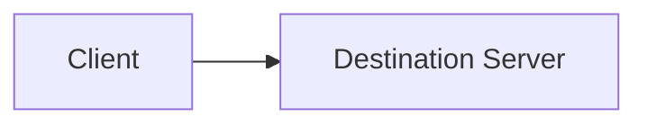
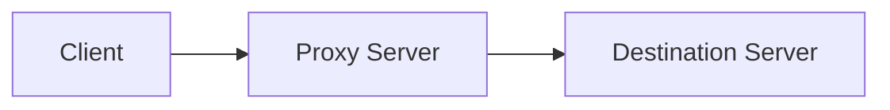
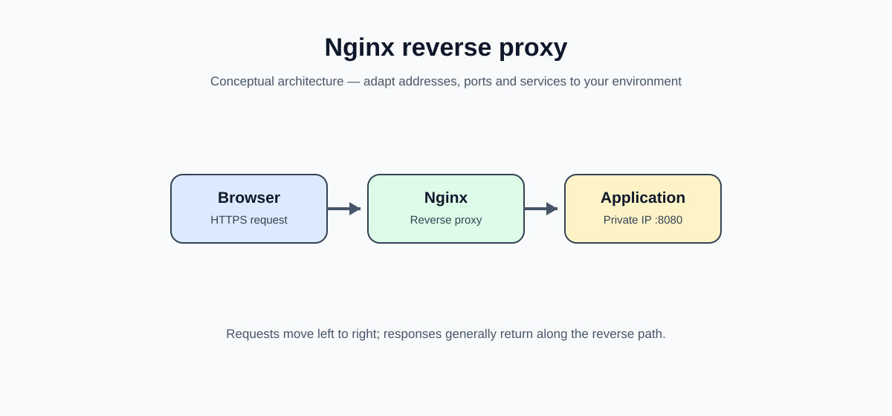
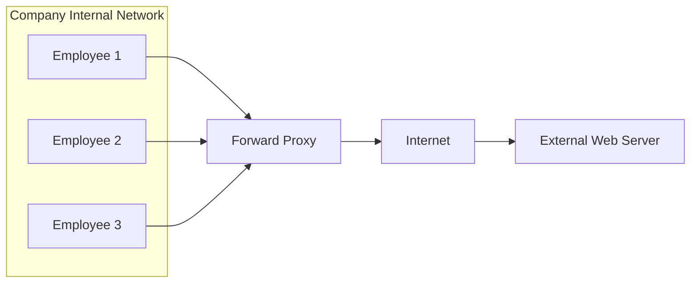
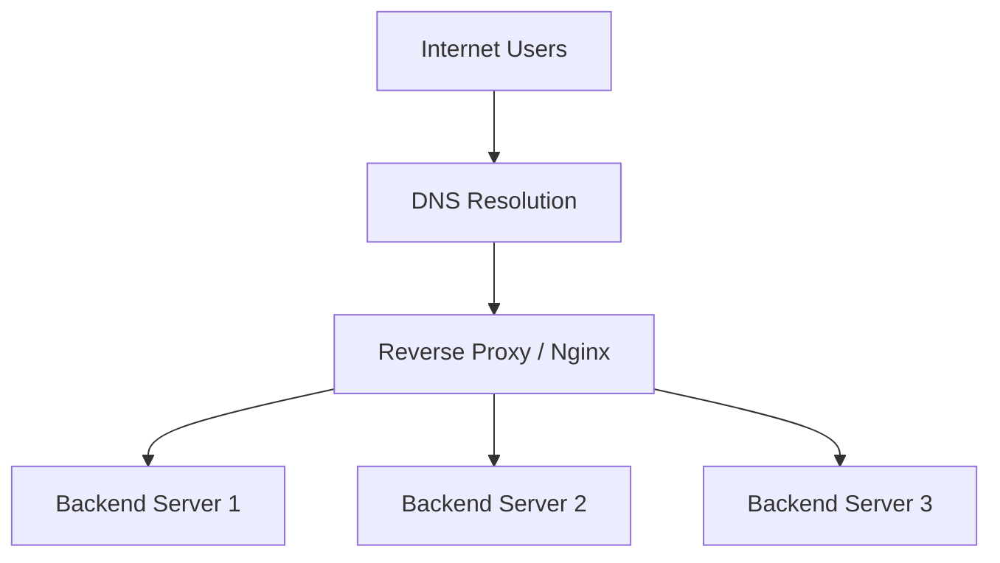
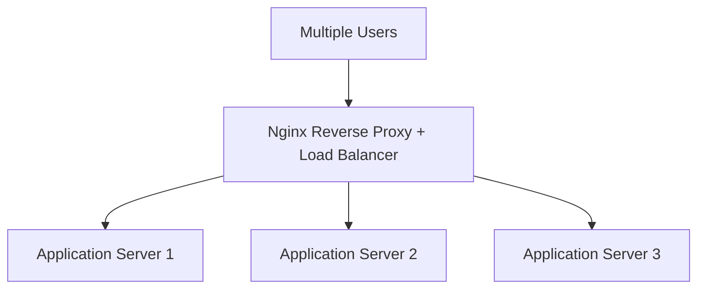

# Proxy, Forward Proxy & Reverse Proxy

Understand what a proxy is, how forward and reverse proxies work, and why they are important in Cloud, DevOps, networking, and system design.


## 1. Learning Objectives

By the end of this topic, you should be able to:

- Understand what a proxy is and why we use it.
- Understand forward proxy and reverse proxy.
- Explain how requests and responses travel through a proxy.
- Identify the differences between forward and reverse proxies.
- Understand real-world use cases.
- Understand how proxies are used in Cloud and DevOps architectures.
- Explain the relationship between reverse proxies and load balancers.

## 2. What is a Proxy?

A **proxy is an intermediate server that sits between two systems and forwards requests on behalf of one of them.**

In simple words, a proxy acts as a middleman between a client and a destination server.

### Without a Proxy

The client communicates directly with the destination server.



### With a Proxy

Instead of communicating directly, the client sends its request to the proxy. The proxy forwards the request to the destination server.



There are two important types of proxies:

1. Forward Proxy
2. Reverse Proxy

## 3. What is a Forward Proxy?

A **forward proxy works on behalf of clients.**

It sits between internal users and external servers and manages outgoing requests.

### Real-world example

Imagine your company has 100 employees.

Your company doesn't want employees to access the internet directly. Instead, all employees must access the internet through a forward proxy server.


### How does it work?

Let's say an employee wants to access:

`https://www.google.com`

The communication happens like this:

1. Employee sends a request to the forward proxy.
2. Forward proxy receives the request.
3. Proxy checks company security policies.
4. If allowed, the proxy forwards the request to Google.
5. Google sends the response back to the proxy.
6. Proxy returns the response to the employee.

### Why do companies use forward proxies?

- Control internet access.
- Block unwanted websites.
- Monitor employee internet traffic.
- Hide internal client IP addresses from destination servers.
- Apply company security policies.
- Cache frequently requested content.

### Real-world example

An organization allows employees to access Google but blocks social media websites through its forward proxy.

## 4. What is a Reverse Proxy?

A **reverse proxy works on behalf of backend servers.**

It sits between external users and internal application servers.

Instead of allowing users to communicate directly with backend servers, users communicate with the reverse proxy. The reverse proxy forwards requests to the appropriate backend server.

### Real-world example

Imagine you have an application:

`https://www.devcloud.store`

Behind this application, you have three backend servers:

- Backend Server 1: `10.0.1.10:8080`
- Backend Server 2: `10.0.1.11:8080`
- Backend Server 3: `10.0.1.12:8080`

Users access the application through a single public entry point.



### How does it work?

1. User accesses `www.devcloud.store`.
2. DNS resolves the domain to the reverse proxy's public IP.
3. Request reaches the reverse proxy.
4. Reverse proxy decides which backend should receive the request.
5. Backend processes the request.
6. Response returns through the reverse proxy to the user.

The user doesn't need to know the backend server's private IP address.

### Why do we use reverse proxies?

- Hide backend server details.
- SSL/TLS termination.
- Route requests to different applications.
- Distribute traffic across backend servers.
- Cache responses.
- Apply security and access-control policies.
- Provide a centralized entry point for backend applications.

## 5. Forward Proxy vs Reverse Proxy

This is the most important difference to remember.

| Feature | Forward Proxy | Reverse Proxy |
|---|---|---|
| Works on behalf of | Clients | Backend servers |
| Main purpose | Manage outgoing traffic | Manage incoming traffic |
| Position | In front of clients | In front of servers |
| Protects/hides | Client network details | Backend infrastructure |
| Example | Squid Proxy | Nginx |

### Easy way to remember

- Forward Proxy = Protects and manages clients going outside.
- Reverse Proxy = Protects and manages servers receiving requests.

## 6. Technical Architecture

### Forward Proxy Architecture



### Reverse Proxy Architecture



## 7. Where Do We Use These Concepts in Cloud and DevOps?

These concepts are widely used in production infrastructure.

| Technology | Usage |
|---|---|
| Squid Proxy | Forward proxy |
| Nginx | Web server and reverse proxy |
| Apache HTTP Server | Web server and reverse proxy |
| HAProxy | Reverse proxy and load balancer |
| AWS Application Load Balancer | Managed Layer 7 load balancing |
| AWS Network Load Balancer | Managed Layer 4 load balancing |

### How is a Reverse Proxy related to Load Balancing?

A reverse proxy receives requests and forwards them to backend servers.

A load balancer distributes incoming traffic across multiple backend servers.

A reverse proxy can also perform load balancing.

For example:



This is why understanding reverse proxies is an important foundation for learning load balancers.

**Important:** A reverse proxy and a load balancer are related concepts, but they are not exactly the same thing. A reverse proxy does not necessarily distribute traffic across multiple servers.

## 8. Practical Tools to Learn

To understand these concepts practically, learn the following tools:

### Forward Proxy

- Squid Proxy
- Proxy configuration on Linux and browsers
- Access control lists (ACLs)
- Proxy logs

### Reverse Proxy

- Nginx
- Apache HTTP Server
- HAProxy
- AWS Application Load Balancer

## 9. Practical Learning Sequence

Follow this order for hands-on practice:

1. Understand proxy fundamentals.
2. Understand forward proxy architecture.
3. Understand reverse proxy architecture.
4. Install and configure Squid Proxy.
5. Configure a client to use the forward proxy.
6. Install Nginx on an EC2 instance.
7. Configure Nginx as a reverse proxy.
8. Forward requests to a backend application using its private IP.
9. Configure Nginx to distribute requests across multiple backend servers.
10. Understand how AWS ALB performs Layer 7 load balancing.

## 10. Common Troubleshooting Scenarios

| Problem | Possible reason |
|---|---|
| Proxy connection refused | Proxy service is stopped or port is not listening |
| 502 Bad Gateway | Reverse proxy cannot get a valid response from backend |
| 504 Gateway Timeout | Backend is taking too long to respond |
| Website not accessible through forward proxy | Proxy ACL, DNS, firewall, or connectivity issue |
| Backend application inaccessible | Security group, routing, application, or port issue |

Useful commands:

```bash
# Check whether Nginx is running
sudo systemctl status nginx

# Check listening ports
sudo ss -tulnp

# Validate Nginx configuration
sudo nginx -t

# View Nginx error logs
sudo tail -f /var/log/nginx/error.log

# Test backend connectivity
curl -I http://10.0.1.10:8080
```

## 11. Important Security Considerations

- Never expose an unrestricted forward proxy to the public internet.
- Restrict backend access to trusted reverse proxies or load balancers.
- Use HTTPS for public application traffic.
- Protect proxy configuration and credentials.
- Configure trusted forwarded headers correctly.
- Monitor proxy access and error logs.

## 12. Interview Questions

1. What is a proxy?
2. What is the difference between a forward proxy and reverse proxy?
3. Why do organizations use forward proxies?
4. Why do we use reverse proxies in production?
5. What is Nginx?
6. Can Nginx work as a reverse proxy?
7. What happens when a reverse proxy cannot connect to its backend?
8. What is the difference between a reverse proxy and a load balancer?
9. What is SSL/TLS termination?
10. How does AWS ALB relate to reverse proxy architecture?

## 13. Production Thinking

When designing or troubleshooting a proxy-based architecture, always identify:

- Who initiates the request?
- Which system receives the request first?
- Which server forwards the request?
- Which ports and protocols are involved?
- Which network boundaries are crossed?
- Where does TLS terminate?
- What happens when the proxy or backend becomes unavailable?
- How do we monitor and troubleshoot failures?

## 14. Key Takeaways

- A proxy is an intermediary between two systems.
- A forward proxy works on behalf of clients.
- A reverse proxy works on behalf of backend servers.
- Nginx is commonly used as a web server and reverse proxy.
- Squid is commonly used as a forward proxy.
- Reverse proxies can also provide load-balancing functionality.
- These concepts form an important foundation for understanding AWS ALB, NLB, and production cloud architectures.

**Next Topic:** Nginx – Installation, Configuration, Web Server and Reverse Proxy Hands-on Lab.
