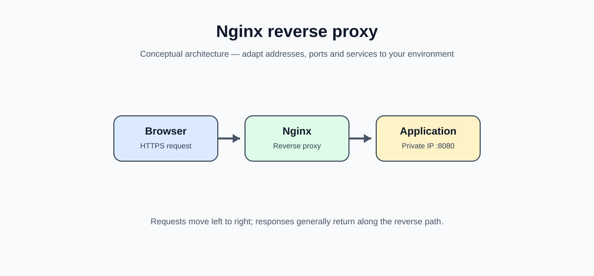

# Nginx Web Server & Reverse Proxy

Install, configure, validate, reload, and troubleshoot Nginx as a web server and reverse proxy.



## Learning objectives
By the end of this topic, you should be able to explain the purpose of the technology, describe the request flow, identify its place in a cloud architecture, and troubleshoot common failures.

## What is Nginx?
Nginx is web-server software that can serve static content and act as a reverse proxy, HTTP load balancer, and cache.

## Install (Amazon Linux 2023)
```bash
sudo dnf install nginx -y
sudo systemctl enable --now nginx
sudo systemctl status nginx
```

## Important paths
- Main config: `/etc/nginx/nginx.conf`
- Additional config: `/etc/nginx/conf.d/*.conf`
- Logs: `/var/log/nginx/access.log` and `/var/log/nginx/error.log`

## Reverse proxy example
Create `/etc/nginx/conf.d/app.conf`:
```nginx
server {
    listen 80;
    server_name app.example.com;

    location / {
        proxy_pass http://10.0.1.10:8080;
        proxy_set_header Host $host;
        proxy_set_header X-Real-IP $remote_addr;
        proxy_set_header X-Forwarded-For $proxy_add_x_forwarded_for;
        proxy_set_header X-Forwarded-Proto $scheme;
    }
}
```
Replace the example private IP and port with your backend's actual address.

Validate and reload:
```bash
sudo nginx -t
sudo systemctl reload nginx
```

## Troubleshooting
- `502 Bad Gateway`: Nginx cannot get a valid response from upstream; check backend health, address, port, route, and security rules.
- `403 Forbidden`: check file permissions, Nginx access rules, and SELinux where applicable.
- `404 Not Found`: check `server_name`, `location`, and upstream application routes.
- Inspect logs: `sudo tail -f /var/log/nginx/error.log`.

## Security notes
- Restrict backend inbound traffic to the Nginx instance/security group where possible.
- Do not blindly trust client-supplied `X-Forwarded-For`; define trusted proxy boundaries.
- Use TLS for public production traffic.


## Production thinking
When applying this topic in a real environment, document:
- The source and destination of traffic.
- Protocols and ports.
- Public and private network boundaries.
- Authentication and encryption requirements.
- Failure behavior and monitoring.
- Operational ownership and rollback procedure.

## Further practice
Draw this architecture from memory, then explain it aloud as if you were describing a production incident or design review.
