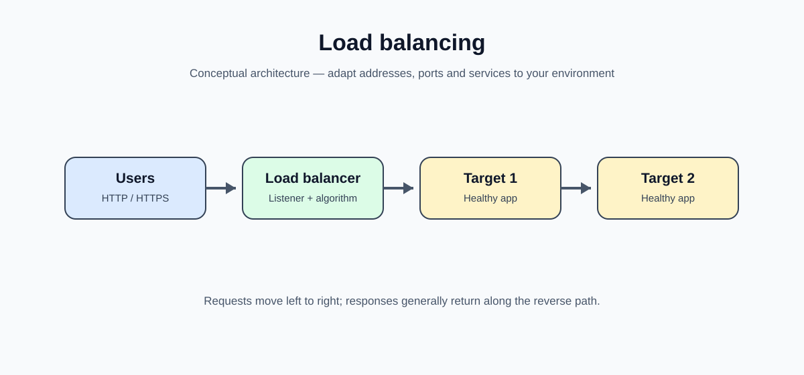

# Load Balancing

Learn why traffic is distributed across multiple targets and how health checks, algorithms, and Layer 4/Layer 7 load balancing work.



## Learning objectives
By the end of this topic, you should be able to explain the purpose of the technology, describe the request flow, identify its place in a cloud architecture, and troubleshoot common failures.

## What is load balancing?
A load balancer distributes incoming connections or requests across multiple backend targets to improve availability, capacity, and resilience.

## Common types
- **Layer 4:** routes using transport information such as IP addresses and TCP/UDP ports.
- **Layer 7:** understands application protocols such as HTTP and can route using hostnames, paths, and headers.

## Algorithms
- Round robin: distributes requests in sequence.
- Least connections: prefers a target with fewer active connections.
- IP hash: uses client IP hashing to select a target; this is not a guarantee of user identity or perfect session persistence.

## Nginx HTTP load-balancing example
```nginx
upstream app_servers {
    server 10.0.1.10:8080;
    server 10.0.1.11:8080;
    server 10.0.1.12:8080;
}

server {
    listen 80;
    location / {
        proxy_pass http://app_servers;
    }
}
```

## AWS mapping
- Application Load Balancer (ALB): Layer 7 HTTP/HTTPS routing.
- Network Load Balancer (NLB): Layer 4 TCP/UDP/TLS use cases.
- Target group: registered destinations and health-check configuration.
- Listener: accepts connections on a protocol and port and applies rules.

## Important caveat
A load balancer improves availability only when targets span appropriate failure domains and the application/data layer is also designed for resilience. A single load balancer configuration cannot fix a single point of failure elsewhere.


## Production thinking
When applying this topic in a real environment, document:
- The source and destination of traffic.
- Protocols and ports.
- Public and private network boundaries.
- Authentication and encryption requirements.
- Failure behavior and monitoring.
- Operational ownership and rollback procedure.

## Further practice
Draw this architecture from memory, then explain it aloud as if you were describing a production incident or design review.
