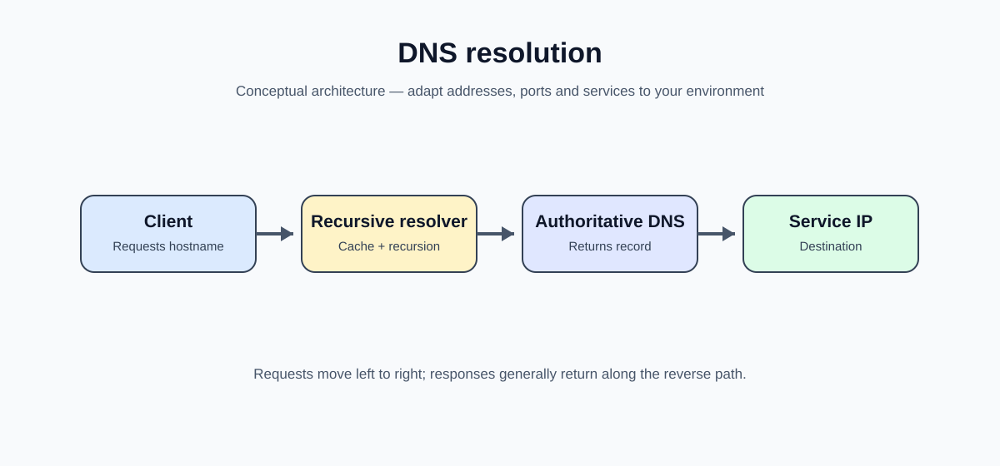
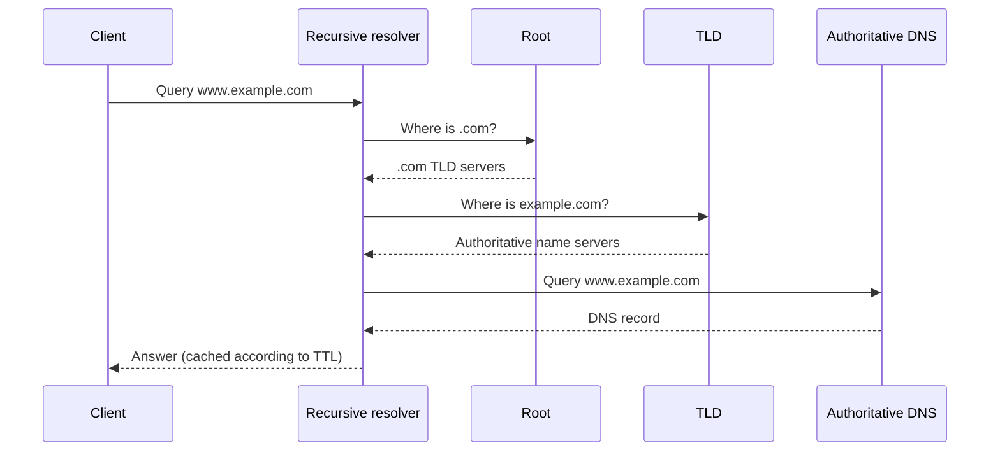

# DNS & Name Resolution

Understand how names are translated into records and IP addresses, including recursive resolvers, authoritative DNS, TTL, and Route 53.



## Learning objectives
By the end of this topic, you should be able to explain the purpose of the technology, describe the request flow, identify its place in a cloud architecture, and troubleshoot common failures.

## What is DNS?
DNS (Domain Name System) maps human-readable names to records such as IP addresses and aliases.

## Main components
- Stub resolver: component on the client that asks a DNS resolver.
- Recursive resolver: finds the answer on the client's behalf, often using cache.
- Root DNS servers: direct resolvers toward the relevant top-level domain.
- TLD DNS servers: direct resolvers toward the domain's authoritative servers.
- Authoritative DNS servers: publish the domain's actual DNS records.

## Typical lookup


## Common record types
- A: name to IPv4 address.
- AAAA: name to IPv6 address.
- CNAME: alias to another DNS name.
- MX: mail exchanger.
- NS: authoritative name servers for a zone.
- TXT: text data used for verification and email policies.
- SOA: zone authority and timing metadata.

## TTL and propagation
TTL tells caches how long a DNS answer may be retained. Changing a record does not instantly clear every resolver's existing cache. Lowering TTL ahead of a planned change can reduce, but not eliminate, the time clients may continue using an old answer.

## Commands
```bash
dig example.com
dig A example.com
dig NS example.com
dig +trace example.com
nslookup example.com
```


## Production thinking
When applying this topic in a real environment, document:
- The source and destination of traffic.
- Protocols and ports.
- Public and private network boundaries.
- Authentication and encryption requirements.
- Failure behavior and monitoring.
- Operational ownership and rollback procedure.

## Further practice
Draw this architecture from memory, then explain it aloud as if you were describing a production incident or design review.
