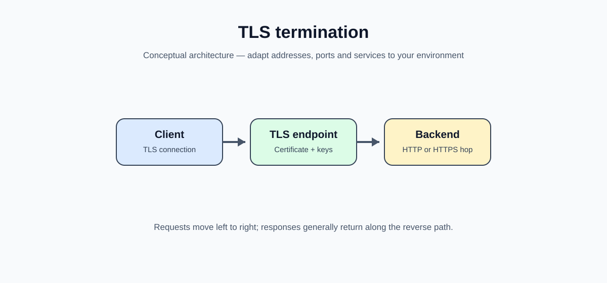

# SSL/TLS & HTTPS

Understand encryption in transit, certificates, certificate authorities, TLS handshakes, and TLS termination at proxies or load balancers.



## Learning objectives
By the end of this topic, you should be able to explain the purpose of the technology, describe the request flow, identify its place in a cloud architecture, and troubleshoot common failures.

## SSL vs TLS
SSL is obsolete. Modern secure web connections use TLS. People may still say “SSL certificate” when they mean a certificate used for TLS.

## What TLS provides
- Encryption: protects data in transit.
- Integrity: detects tampering.
- Authentication: commonly authenticates the server using its certificate.

## Simplified HTTPS flow
1. Client connects to the server's TLS endpoint.
2. Client and server negotiate TLS parameters and key exchange.
3. Server presents its certificate.
4. Client validates certificate chain, hostname, validity, and trust.
5. Both sides derive session keys and exchange encrypted application data.

## TLS termination
TLS can terminate at Nginx or an AWS Application Load Balancer. The proxy/load balancer decrypts the client connection and may establish a separate connection to the backend. If backend traffic crosses an untrusted network, encrypt that hop too.

## Useful commands
```bash
openssl s_client -connect example.com:443 -servername example.com
curl -Iv https://example.com
```

## Production checklist
- Use valid certificates and renew them before expiry.
- Keep TLS versions and cipher configuration current.
- Redirect HTTP to HTTPS where appropriate.
- Protect private keys and restrict access.
- Decide explicitly whether proxy-to-backend traffic also requires TLS.


## Production thinking
When applying this topic in a real environment, document:
- The source and destination of traffic.
- Protocols and ports.
- Public and private network boundaries.
- Authentication and encryption requirements.
- Failure behavior and monitoring.
- Operational ownership and rollback procedure.

## Further practice
Draw this architecture from memory, then explain it aloud as if you were describing a production incident or design review.
