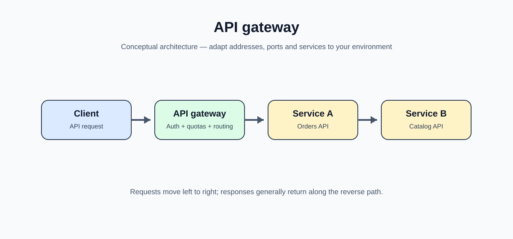
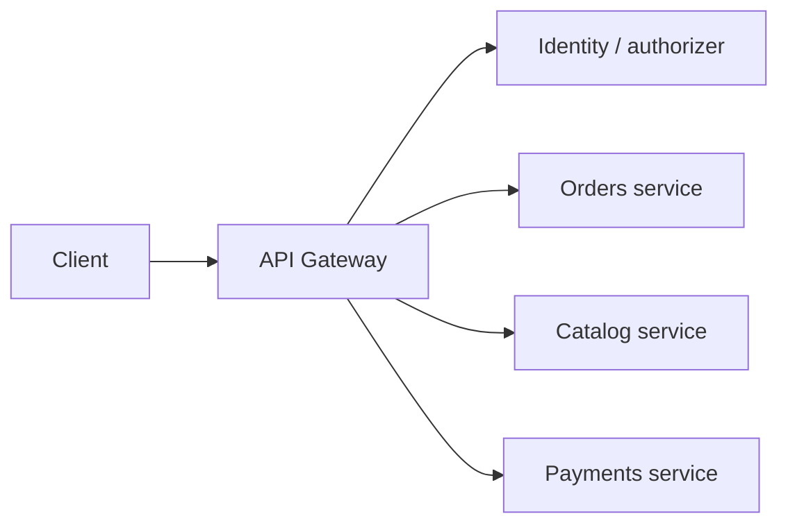

# API Gateway

Learn how an API gateway provides a managed entry point for APIs, including routing, authentication integration, throttling, and observability.

## Learning objectives
By the end of this topic, you should be able to explain the purpose of the technology, describe the request flow, identify its place in a cloud architecture, and troubleshoot common failures.

## What is an API gateway?
An API gateway is an entry point that receives API calls and routes them to appropriate backend services. It often provides cross-cutting API capabilities.

## Common responsibilities
- Route requests to services.
- Authenticate or integrate with identity providers.
- Apply throttling and quotas.
- Validate requests and transform headers/payloads where supported.
- Centralize access logs and metrics.
- Manage API versions and developer access.

## Reverse proxy vs API gateway
An API gateway commonly includes reverse-proxy behavior, but adds API-focused controls and lifecycle features. A reverse proxy is a broader pattern and may simply forward web traffic.

## Example architecture

## Design cautions
- Avoid putting business logic into the gateway.
- Define timeouts, retry policies, and rate limits carefully.
- Retries can amplify load; use bounded retries and idempotency for operations that may be repeated.
- Do not treat routing as a substitute for service-level authorization.

## Production thinking
When applying this topic in a real environment, document:
- The source and destination of traffic.
- Protocols and ports.
- Public and private network boundaries.
- Authentication and encryption requirements.
- Failure behavior and monitoring.
- Operational ownership and rollback procedure.

## Further practice
Draw this architecture from memory, then explain it aloud as if you were describing a production incident or design review.
