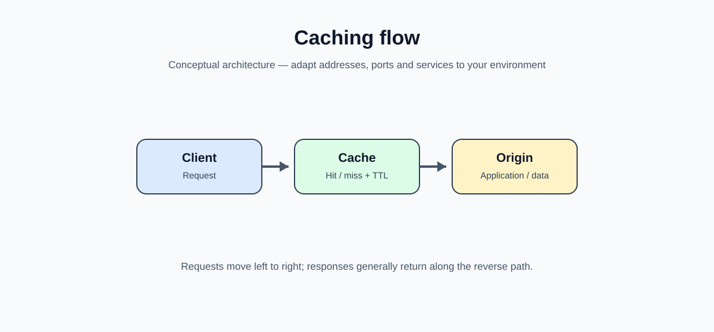
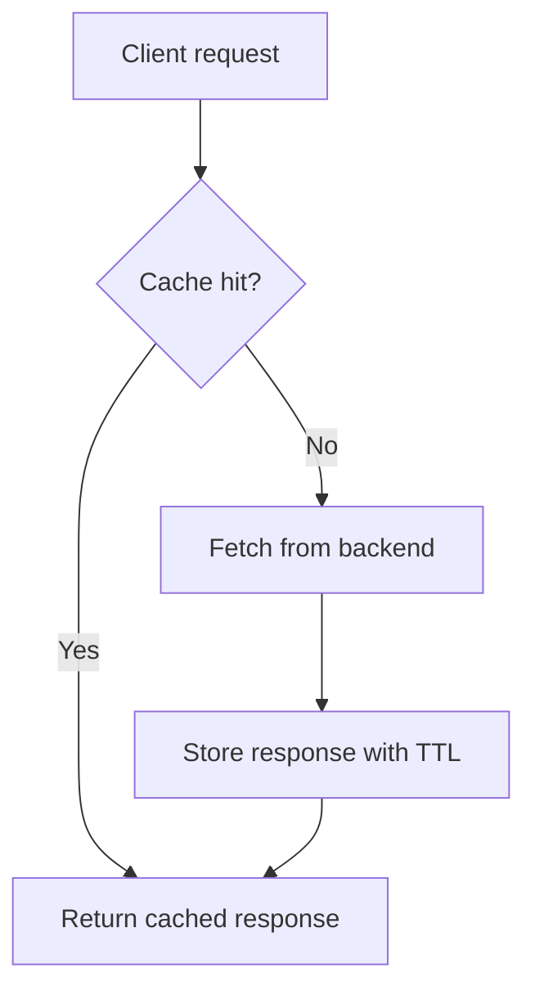

# Caching

Understand how caching reduces latency and backend load, and how to reason about cache keys, TTL, invalidation, and consistency.

## Learning objectives
By the end of this topic, you should be able to explain the purpose of the technology, describe the request flow, identify its place in a cloud architecture, and troubleshoot common failures.

## What is caching?
Caching stores a reusable copy of data closer to the consumer so later requests can be served faster or with less work.

## Common cache locations
- Browser cache.
- CDN/edge cache.
- Reverse-proxy cache.
- Application cache (for example Redis).
- Database buffer/cache.

## Basic flow

## Important terms
- Cache hit: requested object is present and usable.
- Cache miss: object is absent or expired.
- TTL: how long an entry may remain fresh.
- Invalidation: removing or refreshing stale entries.
- Cache key: attributes used to identify an entry.

## Design cautions
- Cache only data that is safe to reuse across the cache key.
- Be careful with user-specific responses and cookies.
- Define freshness requirements before choosing TTL.
- Cache invalidation and stale data are application design concerns, not just configuration details.

## Production thinking
When applying this topic in a real environment, document:
- The source and destination of traffic.
- Protocols and ports.
- Public and private network boundaries.
- Authentication and encryption requirements.
- Failure behavior and monitoring.
- Operational ownership and rollback procedure.

## Further practice
Draw this architecture from memory, then explain it aloud as if you were describing a production incident or design review.
