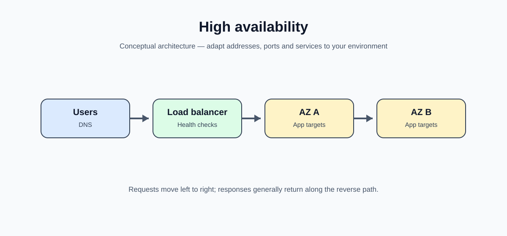
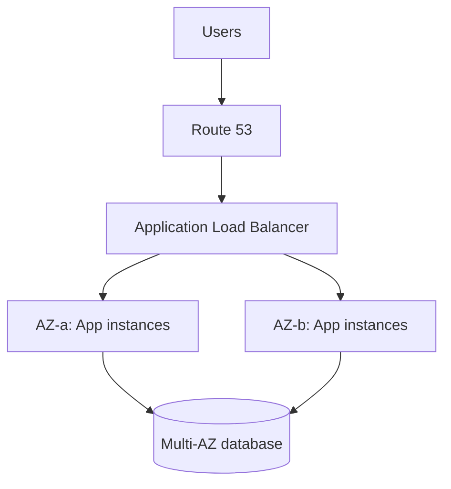

# High Availability & Reliability

Design systems to continue serving users through component failures using redundancy, health checks, fault isolation, and recovery planning.

## Learning objectives
By the end of this topic, you should be able to explain the purpose of the technology, describe the request flow, identify its place in a cloud architecture, and troubleshoot common failures.

## What is high availability?
High availability (HA) aims to minimize service downtime. It is achieved through architecture, operations, monitoring, and tested recovery—not by a single product.

## Core techniques
- Remove single points of failure.
- Run redundant application instances across Availability Zones.
- Use health checks and remove unhealthy targets from service.
- Back up data and test restores.
- Define recovery time objective (RTO) and recovery point objective (RPO).
- Monitor service-level indicators and alert on user impact.

## Example AWS architecture

## Failure scenarios to test
- One application instance stops responding.
- One Availability Zone becomes unavailable.
- Database failover occurs.
- A deployment introduces a bad release.
- Traffic increases beyond expected capacity.

## Important distinction
Multi-AZ improves availability within a Region; it is not automatically a complete disaster-recovery strategy for a Region-wide outage.

## Production thinking
When applying this topic in a real environment, document:
- The source and destination of traffic.
- Protocols and ports.
- Public and private network boundaries.
- Authentication and encryption requirements.
- Failure behavior and monitoring.
- Operational ownership and rollback procedure.

## Further practice
Draw this architecture from memory, then explain it aloud as if you were describing a production incident or design review.
