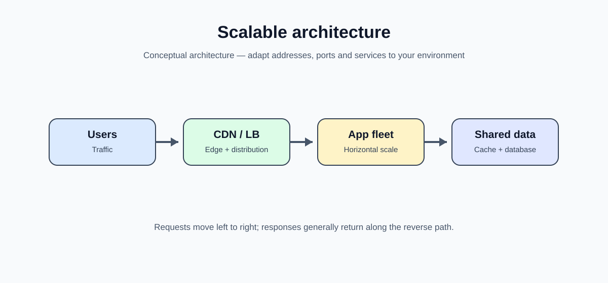
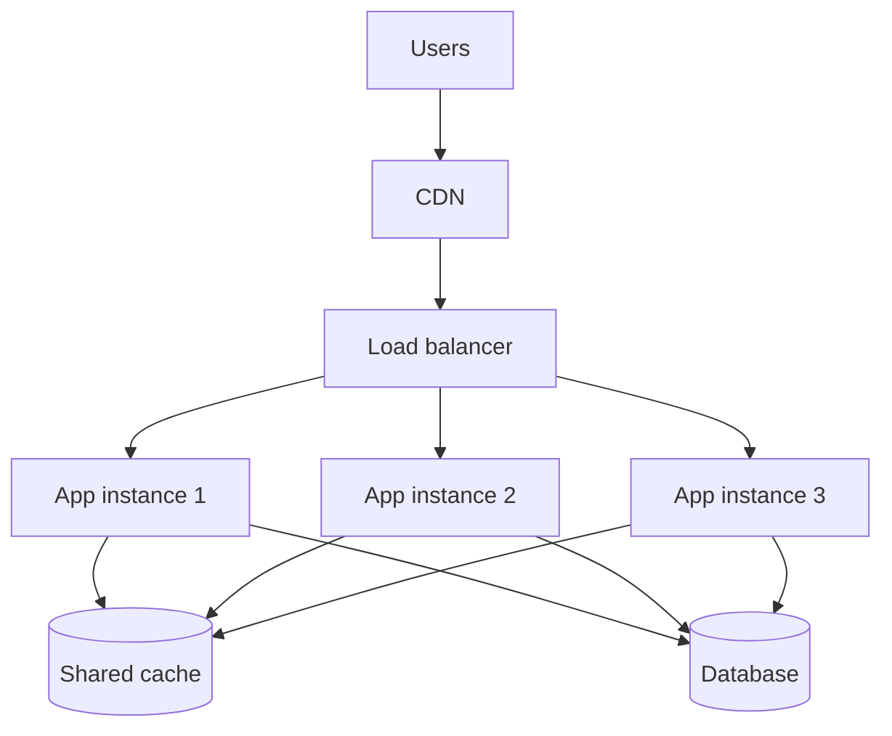

# Scalability & Performance

Understand vertical and horizontal scaling, bottlenecks, autoscaling, stateless services, and capacity planning.

## Learning objectives
By the end of this topic, you should be able to explain the purpose of the technology, describe the request flow, identify its place in a cloud architecture, and troubleshoot common failures.

## What is scalability?
Scalability is a system's ability to handle increased workload by adding or using resources effectively while meeting performance and reliability goals.

## Two main approaches
- Vertical scaling: increase resources on one machine (CPU/RAM).
- Horizontal scaling: add more machines/instances and distribute workload.

## Typical scalable web architecture

## Design principles
- Keep application instances stateless where practical.
- Store shared session/state in a suitable shared service.
- Measure CPU, memory, latency, throughput, error rate, and saturation.
- Identify the actual bottleneck before scaling.
- Use autoscaling policies aligned with workload and startup time.
- Protect databases and downstream dependencies from sudden traffic spikes.

## Interview checks
- Compare vertical and horizontal scaling.
- Why are stateless services easier to scale?
- Why can adding application instances make database overload worse?

## Production thinking
When applying this topic in a real environment, document:
- The source and destination of traffic.
- Protocols and ports.
- Public and private network boundaries.
- Authentication and encryption requirements.
- Failure behavior and monitoring.
- Operational ownership and rollback procedure.

## Further practice
Draw this architecture from memory, then explain it aloud as if you were describing a production incident or design review.
