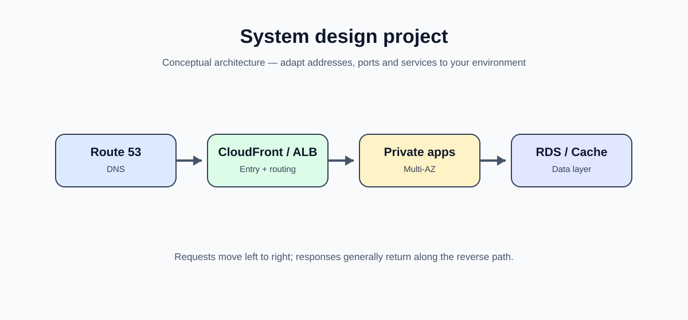
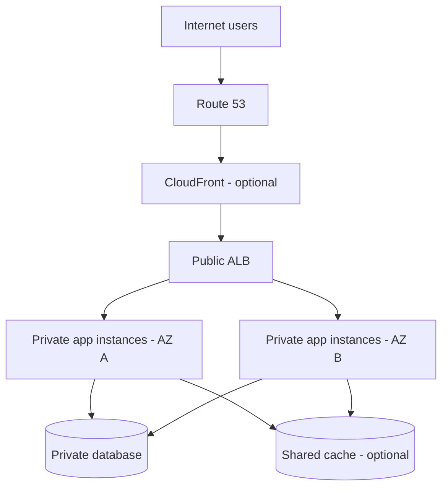

# System Design Projects

Practice combining networking, proxies, load balancing, caching, security, application services, and data stores into coherent architectures.

## Learning objectives
By the end of this topic, you should be able to explain the purpose of the technology, describe the request flow, identify its place in a cloud architecture, and troubleshoot common failures.

## Project 1: Highly available web application
Requirements:
- Public DNS name.
- HTTPS for users.
- Load-balanced application instances in at least two Availability Zones.
- Private database connectivity.
- Health checks, logs, metrics, and backups.

## Project 2: Nginx reverse proxy lab
- Create one proxy VM and one backend VM.
- Run a simple HTTP app on the backend.
- Configure Nginx to forward requests to the backend private IP.
- Restrict backend ingress to the proxy security group.
- Test success and deliberately break the upstream to observe a 502.

## Project 3: Nginx load-balancing lab
- Run the same app on three backend instances.
- Configure an Nginx upstream group.
- Return a hostname from each backend to observe distribution.
- Stop one backend and observe behavior. Note that open-source Nginx passive failure handling is not identical to a managed active health-check system.

## Project 4: AWS ALB lab
- Create an ALB in public subnets across two AZs.
- Create a target group for private application instances.
- Configure listener rules and health checks.
- Verify that unhealthy targets stop receiving normal traffic.
- Review ALB access logs and CloudWatch metrics.

## Design review checklist
- Are trust boundaries and network paths explicit?
- Are backend instances private?
- Are security group rules least-privilege?
- What happens if one target, AZ, or dependency fails?
- Where does TLS terminate, and is backend traffic encrypted if needed?
- What are the scaling limits and database bottlenecks?
- How are logs, metrics, traces, backups, and alerts handled?

## Production thinking
When applying this topic in a real environment, document:
- The source and destination of traffic.
- Protocols and ports.
- Public and private network boundaries.
- Authentication and encryption requirements.
- Failure behavior and monitoring.
- Operational ownership and rollback procedure.

## Further practice
Draw this architecture from memory, then explain it aloud as if you were describing a production incident or design review.
