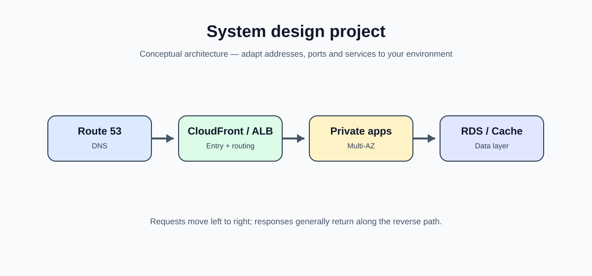

# 04 — Networking and System Design

A beginner-to-advanced learning path for Cloud & DevOps engineers. This section connects networking fundamentals to production application architecture.

## Learning outcomes
By completing these labs, you should be able to explain how a request travels from a user to an application, configure a reverse proxy, distribute traffic, reason about DNS and TLS, and design resilient cloud architectures.

## Recommended order
1. [Computer Networking](01_Computer_Networking/README.md)
2. [Proxy and Reverse Proxy](02_Proxy_and_Reverse_Proxy/README.md)
3. [Nginx](03_Nginx/README.md)
4. [Load Balancing](04_Load_Balancing/README.md)
5. [DNS](05_DNS/README.md)
6. [SSL/TLS](06_SSL_TLS/README.md)
7. [API Gateway](07_API_Gateway/README.md)
8. [Caching](08_Caching/README.md)
9. [High Availability](09_High_Availability/README.md)
10. [Scalability](10_Scalability/README.md)
11. [System Design Projects](11_System_Design_Projects/README.md)

## Architecture at a glance

## How to use this repository
- Read the concept and draw the request flow yourself.
- Recreate the architecture in a lab before moving to the next topic.
- Replace example IPs, ports, domains, and AWS resources with your own lab values.
- Record commands, expected output, errors, and fixes.
- Destroy unused cloud resources to avoid unexpected charges.

## Important lab safety
- Never expose databases or backend application ports publicly unless there is a specific, justified requirement.
- Do not create an unrestricted public forward proxy.
- Store credentials and private keys securely; never commit them to Git.
- Use least-privilege security-group rules.
- Treat example IP addresses and domains as placeholders.

## Folder structure
Each topic folder contains its own `README.md`. Shared architecture illustrations are in `assets/` and are referenced using relative paths.
